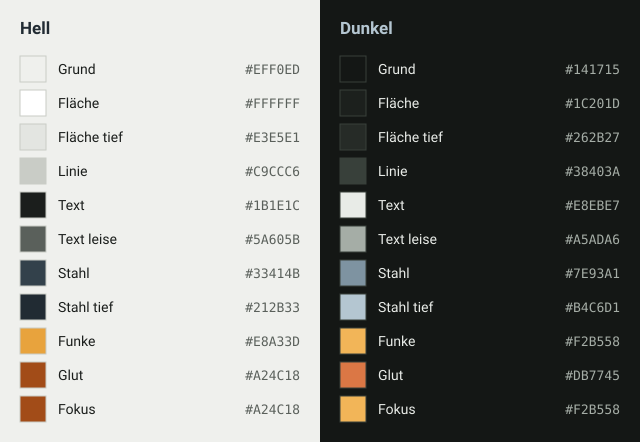

# Firestrike-Branding

Farben, Schrift, Logos und Vorlagen für alle Firestrike-Oberflächen: Website, Anmeldeseite und Apps. Jedes Projekt nimmt seine Werte von hier, statt sie abzuschreiben. So sieht alles gleich aus, und eine Änderung erreicht alle.



## Leitbild: Feuerstein auf Stahl

Feuerstein schlägt auf Stahl, ein Funke springt. Daher ein kühler Stahlgrund und ein einziger warmer Akzent. Kein Signalrot, kein zweiter Akzent, keine Verläufe. Kanten bleiben Kanten. Es gibt nur Systemschriften, damit beim Aufruf kein fremder Server kontaktiert wird. Die Regeln im Einzelnen stehen in [docs/nutzung.md](docs/nutzung.md).

## Inhalt

| Pfad | Inhalt |
|---|---|
| [`tokens/firestrike.json`](tokens/firestrike.json) | Quelle der Wahrheit: Farbrollen hell und dunkel, Kontrastpaare, Schrift, Form, Größen und Abstände |
| [`exporte/`](exporte) | fertige Dateien je Plattform, erzeugt aus den Tokens |
| [`logos/`](logos) | Logo für helles und dunkles Thema, einfarbig, Symbol |
| [`kacheln/`](kacheln) | Vorlage für Kacheln von Diensten und Apps |
| [`docs/`](docs) | Nutzungsregeln, Kontrasttabelle, Farbtafel, [Größen und Abstände](docs/masse.md) |
| [`werkzeuge/marke.py`](werkzeuge/marke.py) | erzeugt die Exporte, prüft alles und gleicht Kopien in Projekten ab |
| [`tests/abgleich/`](tests/abgleich) | Prüfdateien für den Abgleich, je Format eine passende und eine abweichende |
| [`tests/werkzeug/`](tests/werkzeug) | Tests für `marke.py` selbst, etwa dass fehlende Logos als Befund erscheinen |

## Exporte

| Plattform | Datei | Namen |
|---|---|---|
| Web (CSS) | `exporte/firestrike.css` | `--fs-grund`, `--fs-glut` …, `--fs-groesse-gross`, `--fs-abstand-30` … |
| Sass | `exporte/_firestrike.scss` | `$fs-glut`, `$fs-glut-dunkel`, `$fs-groesse-gross`, Maps `$fs-hell`, `$fs-dunkel`, `$fs-groessen` und `$fs-abstaende` |
| WordPress | `exporte/wordpress/firestrike.json`, `exporte/wordpress/farben.css` | Palette, Schriften, Größen und Abstände für theme.json, dunkles Thema für style.css |
| Avalonia | `exporte/avalonia/Firestrike.axaml` | `Fs.Grund`, `Fs.Grund.Color` …, `Fs.Groesse.Gross`, `Fs.Abstand.30` … |
| WinUI 3 | `exporte/winui/Firestrike.xaml` | `FsGrundBrush`, `FsGrundColor` …, Akzentreihe `SystemAccentColor` bis `SystemAccentColorDark3`, Wörterbuch `HighContrast`, `FsGroesseGross` … |
| Anmeldeseite (PatternFly) | `exporte/anmeldeseite.css` | eigenes CSS der Anmeldeseite |
| Rasterbilder | `exporte/raster/` | Favicon (`favicon.ico` mit 16, 32 und 48 px, `favicon-32.png`), WordPress-Site-Icon (`site-icon-512.png`), Apple-Touch-Icon (`apple-touch-icon-180.png`), Profilbild (`profilbild-400.png`), Windows (`app.ico` mit 16 bis 256 px, `msix/` mit den Größen für MSIX) |

Schriftgrößen, Abstände und Zeilenhöhen stehen in [docs/masse.md](docs/masse.md). Im Web wachsen die größeren Schriftgrößen mit der Fensterbreite, so wie WordPress es rechnet; Apps nehmen die feste Größe.

Im Web folgt Dunkel der Einstellung des Geräts. `data-theme="light"` oder `data-theme="dark"` am `<html>` legt das Thema fest. Jede Datei nennt im Kopf ihre Quelle und Version. Bitte kopierte Dateien nicht anpassen, sondern bei einer neuen Version ganz ersetzen.

WinUI 3 bekommt zusätzlich eine Akzentreihe aus Glut und Funke. WinUI nimmt im hellen Thema Dark1 für Akzentflächen und Dark2 für Verweise, im dunklen Thema Light2 und Light3; die Prüfung hält jedes dieser Paare bei mindestens 4,5:1 ([docs/kontraste.md](docs/kontraste.md#winui-akzentreihe)). Im Modus Hoher Kontrast zeigt jede Rolle auf eine Systemfarbe, die Akzentreihe bleibt dort die des Systems. Die Datei gehört in App.xaml nach `XamlControlsResources`.

## Ändern

1. `tokens/firestrike.json`, ein Logo oder eine Vorlage anpassen.
2. `python3 werkzeuge/marke.py erzeugen`, nach einer Änderung am Symbol auch `python3 werkzeuge/marke.py raster` (braucht `rsvg-convert` aus dem Paket librsvg2-bin)
3. `python3 werkzeuge/marke.py pruefen`, nach einer Änderung an `marke.py` auch `python3 -m unittest discover -s tests/werkzeug`
4. Pull Request stellen.

Die Prüfung läuft auch bei jedem Push und Pull Request, dazu die Tests unter `tests/werkzeug`. Ein zweiter Job erzeugt dort die Rasterbilder mit `rsvg-convert` neu, damit der Befehl lauffähig bleibt. Hat `rsvg-convert` dort dieselbe Version, mit der die eingecheckten Bilder entstanden sind (`werkzeug` in `exporte/raster/quellen.json`), müssen die neuen Bilder byte-gleich sein. Die Prüfung schlägt fehl, wenn

- ein Kontrastpaar in einem der beiden Themen unter seinem Mindestwert liegt (Text 4,5:1, Fokusrahmen 3:1, siehe [docs/kontraste.md](docs/kontraste.md)),
- eine erzeugte Datei nicht mehr zu den Tokens passt,
- ein Rasterbild nicht mehr zum Stand seines Quell-SVG passt oder andere Maße hat; die Prüfsummen der Quellen stehen in `exporte/raster/quellen.json`, die Bilddaten selbst vergleicht niemand,
- `abgleichen` an einem eigenen Export eine Abweichung findet oder eine Prüfdatei unter `tests/abgleich/` nicht das Ergebnis aus `erwartet.json` liefert: dieselben Befunde und, als eigener Aufruf des Befehls, dieselben Exit-Codes mit und ohne `--streng`, bei unbrauchbaren Dateien auch derselbe Grund der Ablehnung (Stichwort `grund`) (bei neuen Tokenwerten die Prüfdateien mit anpassen),
- ein SVG Skripte, Ereignis-Attribute, Verweise nach außen oder Farben außerhalb der Marke enthält oder `role="img"` und `aria-label` fehlen.

Python 3.10 oder neuer genügt, weitere Pakete braucht es nicht.

## Abgleichen

Projekte, die Werte von hier übernehmen, prüfen in ihrer CI, ob ihre Kopie noch stimmt. Die Prüfung liegt hier, damit nur eine Stelle die Tokens auslegt.

```bash
python3 werkzeuge/marke.py abgleichen DATEI [--format FORMAT] [--streng]
```

- Das Format folgt aus der Endung: `.css`, `.scss`, `.axaml` (Avalonia), `.xaml` (WinUI 3) und `.json` (WordPress, `theme.json`). Sonst `--format css`, `scss`, `avalonia`, `winui` oder `wordpress`.
- Verglichen wird jede Rolle in beiden Themen, die die Datei nennt. Dazu kommen Radius, Fokusrahmen, Schriften, Größen, Abstände und Satz, soweit das Format sie trägt. Groß- und Kleinschreibung zählen nicht, `#fff` ist `#FFFFFF`. Verweise wie `var(--fs-glut)`, `$fs-glut`, `{StaticResource Fs.Glut.Color}` oder `{ThemeResource FsGlutColor}` werden aufgelöst.
- CSS: Hell steht im Grundblock, dunkel unter `@media (prefers-color-scheme: dark)` und unter `[data-theme="dark"]`; `@media not …` kehrt das um. Neben `--fs-<rolle>` zählt auch `--wp--preset--color--<rolle>`, damit auch das `style.css` eines WordPress-Themes prüfbar ist. Escapes im Namen und Zeichenketten lesen sich wie im Browser.
- Sass: `$fs_glut` ist `$fs-glut`, und `"glut"` als Map-Schlüssel ist `glut`. `$fs-hell` und `$fs-dunkel` müssen als Map stehen; `map.merge()` und Ähnliches lässt sich nicht auswerten und ist ein Fehler.
- Avalonia und WinUI: Ein Wert außerhalb der Themenwörterbücher gilt in jedem Thema, denn beide suchen dort zuerst. Bei WinUI zählen auch die Akzentreihe und die Systemfarben im Wörterbuch `HighContrast`. Bei Avalonia erben `Light` und `Dark` von `Default`: Ein Wert aus `Default` gilt in jedem Thema, dessen eigenes Wörterbuch ihn nicht setzt, und wird dort mit den Tokens dieses Themas verglichen. Bei WinUI ist `Default` das dunkle Thema. Gezählt wird je Rolle und Thema getrennt, ob Farbe und Pinsel da sind (`FsGlutColor` und `FsGlutBrush`, `Fs.Glut.Color` und `Fs.Glut`), bei WinUI auch im Hohen Kontrast, und ob die Stufen der Akzentreihe in beiden Themen stehen.
- WordPress: Slugs zählen so, wie WordPress sie zur CSS-Variable macht (`Glut` ist `glut`, `flaecheTief` ist `flaeche-tief`), und der letzte Eintrag gewinnt. Verglichen werden auch die Fensterbreiten der fließenden Größen (`settings.typography.fluid`, ohne eigene Angabe `layout.wideSize` oder 1600px) und ein abweichendes `minFontSize`.
- Jede Abweichung steht mit Rolle, Thema, Soll, Ist und Zeile in der Ausgabe, der Exit-Code ist dann 1. Die alten Glutwerte `#AB5019` und `#D9713C` nennt die Ausgabe überall, wo sie in der Datei stehen; auch das ist ein Fehler.
- Was fehlt, ist ein Hinweis, mit `--streng` ein Fehler. Unbekannte Namen wie `--fs-orange` sind Hinweise.
- Exit-Code 2: Die Datei fehlt, ist kein gültiges XML oder JSON, lässt sich nicht lesen (zu tief verschachtelt, zu große Zahl), ist größer als 2 MB oder enthält keinen Wert der Marke.
- Nur Standardbibliothek, kein Netzzugriff. Die Datei wird nur gelesen.

Im Projekt holt der Schritt dieses Repo auf einem festen Commit, nie über `main`. Einen neueren Commit zu übernehmen ist ein bewusster Schritt im Projekt.

```bash
git clone --quiet https://github.com/Celestial0579/firestrike-branding.git "$RUNNER_TEMP/marke"
git -C "$RUNNER_TEMP/marke" checkout --quiet <commit>
python3 "$RUNNER_TEMP/marke/werkzeuge/marke.py" abgleichen app/styles/_firestrike.scss --streng
```

Wo keine Actions laufen, gehört der Schritt in die lokale CI. Dateien ohne eigene CI prüft, wer sie ändert, danach von Hand mit demselben Befehl: eine `theme.json` als `wordpress`, ein `style.css` als `css`.

## Lizenz

Code, Tokens, Exporte und Doku stehen unter der [MIT-Lizenz](LICENSE). **Ausgenommen sind Logos, Wortmarke, Symbol und Kacheln** in `logos/` und `kacheln/` und die Rasterbilder daraus in `exporte/raster/`. Für sie gilt [MARKE.md](MARKE.md).

## Sicherheit

Schwachstellen bitte nicht als Issue melden, sondern so, wie es in [SECURITY.md](SECURITY.md) steht.
